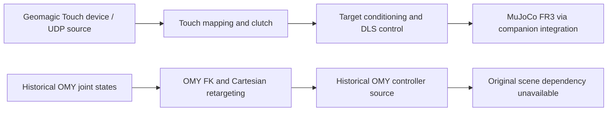

# Franka Teleoperation

## Overview

This repository implements a teleoperation stack for a **MuJoCo-simulated Franka FR3**, using Geomagic Touch and historical OMY-L100 leader inputs.

The control pipeline includes **Cartesian mapping, damped least-squares inverse kinematics, null-space posture control, clutching, motion conditioning, and contact-force-based haptic command generation**.

**Public v1 is a source/reference release.** It includes the Geomagic Touch device interface, bridge, mapping and control source, haptic implementation, CPU regression tests, and the historical OMY-L100 teleoperation source.

**Historical reproduction limit:** the original OMY MuJoCo scene/model bundle was not committed, and its exact asset provenance could not be recovered. Remaining local model copies are modified derivatives and are not used as substitutes. Original OMY launchers/configs are preserved as reference code; this repository does **not** provide a ready-to-run reconstruction of the original OMY environment. **Physical Franka deployment is not claimed.**

The two interfaces have distinct implementations and validation scopes. Current Touch software is tested with synthetic input and CPU MuJoCo; historical OMY coverage is limited to source and mathematical tests. [Validation evidence](docs/VALIDATION.md) and [release boundaries](docs/PUBLIC_V1_SCOPE.md) define those claims.

## Demo / Architecture

Historical OMY teleoperation demo — archival evidence, not a current reproduction

This recording documents the earlier system. It does not establish that its missing scene assets can be reconstructed from this release.

## Current Interface — Geomagic Touch

The `geomagic/` tree contains the device interface, UDP transport, Cartesian position/orientation mapping, clutch anchors, target conditioning, DLS/null-space related control, diagnostics, and contact-force haptic implementation. Reference helpers and the adapted runtime remain separate; no common controller was extracted.

CPU tests cover these software paths using existing synthetic input/protocol fixtures and MuJoCo. The public device and haptic source is included, but OpenHaptics headers/runtime and physical Touch hardware are external. SDK compilation, physical haptic acceptance, device timing and hard real-time performance are separate, unverified release gates.

## Historical Interface — OMY-L100

The original layout is retained: `teleop`, `simul`, `launch/`, `src/` and `config/`. It records OMY-L100 joint-state input, FK-based Cartesian retargeting, pose mapping, DLS inverse kinematics, null-space control, clutch/command conditioning, diagnostics and collision-feedback computation.

The [architecture](docs/development.md), [debugging record](docs/debugging.md) and [original OMY setup notes](docs/omy_l100_teleop.md) are historical references. Their commands and model paths describe the earlier installation, not a ready-to-run public setup. The exact scene bundle, including the custom front wall and related sensor modifications, is unavailable. The OMY mathematical tests do not validate model loading, ROS bringup or hardware operation.

## Control Pipeline

Both interfaces use Cartesian commands, but retain their own mapping and implementation:

1. Read the device pose, or derive the historical OMY pose through FK.
2. Capture clutch anchors and map relative position/orientation into a command pose.
3. Apply target/command conditioning and motion limits.
4. Compute DLS joint commands with the interface's null-space behavior.
5. Apply commands through the corresponding simulator integration.

For Touch, see [pose mapping](geomagic/teleop/pose_mapper.py), [controller](geomagic/teleop/fr3_target_controller.py) and [backend](geomagic/leader/teleop_backend.py). For historical OMY, see the [original bridge source](launch/FR3_omy_bridge.py). Source publication does not imply identical gains, coordinate conventions or validation across the two paths.

## Validation

| Evidence | Scope |
| --- | --- |
| 672 Geomagic tests | Existing CPU software regressions; no physical device acceptance claim |
| 6 OMY mathematical tests | Four tests execute pure functions from the shipped bridge; two retain the historical mathematical checks |
| 2,800-step control equivalence | Four synthetic Touch input modes; frozen and relocated public snapshots produce identical recorded control/state arrays |
| Source freeze | Controller, gains, mapping, DLS/null-space and conditioning remain unchanged during release-contract revision |

See [test results, evidence hashes and limitations](docs/VALIDATION.md). Tests do not establish original OMY scene reproduction, physical Franka control, policy success rates or hard real-time guarantees.

## Repository Structure

| Path | Purpose |
| --- | --- |
| `geomagic/device/`, `geomagic/bridge/` | Public Touch device/transport source; SDK is external |
| `geomagic/teleop/`, `geomagic/leader/`, `geomagic/standalone/` | Mapping, control, integration and haptic source |
| `geomagic/vendor/` | Preserved reference/helper snapshots and provenance |
| `geomagic/tests/`, `tests/` | Public CPU regressions and historical OMY mathematics |
| `hardware_validation/` | Explicit SDK-dependent checks, outside the CPU test collection |
| `teleop`, `simul`, `launch/`, `src/`, `config/` | Historical OMY source/reference layout |
| `docs/`, `provenance/` | Architecture, validation and source-cutoff evidence |

## Installation / Dependencies

Start with [INSTALL.md](INSTALL.md). Source inspection and OMY mathematical tests do not require the missing scene bundle. Full Touch integration regressions use a paired checkout of `franka-imitation-learning` and its documented CPU dependencies. Device operation additionally requires OpenHaptics and hardware; historical ROS/OMY launch commands are reference material.

## Reproducibility & Historical Limitations

The source cutoff and per-file hashes are preserved in [SOURCE_CUTOFF.json](provenance/SOURCE_CUTOFF.json). Later research-workspace changes are not automatically incorporated.

The original OMY vendor trees were excluded from Git. A later migration explicitly removed the FR3 collision-test wall, wrist F/T sensors and F/T site. That modified copy cannot establish the original scene's bytes or contact behavior. No derivative scene, latest upstream model, guessed wall/sensor patch or invented historical asset hash is installed here. [Historical asset findings](docs/HISTORICAL_OMY_LIMITATIONS.md) record the available evidence.

This limitation is part of the source/reference release contract. It is not a claim that the original executable environment has been recovered.

## Related Robot Learning Repository

The companion [franka-imitation-learning](https://github.com/jack2148/franka-imitation-learning) repository contains Square demonstration collection, LeRobot dataset construction, ACT / Diffusion Policy training interfaces, and frozen TEST50 evaluation.

The companion reports ACT **27/50 (54%)** and Diffusion Policy **43/50 (86%)** on the same frozen TEST50 of 50 different initial states. These results describe the evaluated checkpoints and do not establish general algorithm superiority.

## Third-Party / Provenance

See [THIRD_PARTY.md](THIRD_PARTY.md) for source provenance, author permission and external SDK boundaries. Existing notices remain authoritative; no blanket license or rights to absent assets are inferred. The original OMY history base is retained, and historical and current control implementations are not presented as one implementation.
